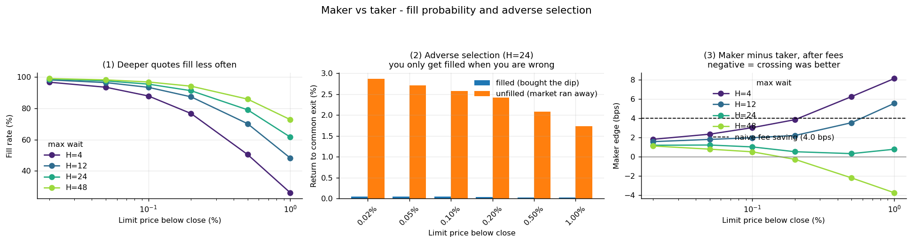
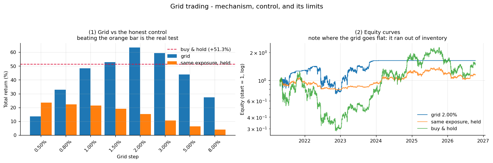

# OKX 执行成本实验室 · okx-execution-lab

> **你的钱到底被谁拿走了？** 三个可复现的实验，量化加密交易的**真实成本** ——
> 逐层拆开价差、冲击和手续费，检验"挂单一定比吃单划算"这个流行说法，
> 以及回答"网格到底能不能赚钱"。
>
> **Where does your trading cost actually go?** Three reproducible experiments on the
> real cost of crypto trading: decomposing spread / impact / fees, testing the popular
> "posting limits is always cheaper" claim, and putting grid trading on trial.

[](https://www.python.org/)
[](LICENSE)
[](#quick-start)

**不需要 API Key，不需要交易所账号。** 全部使用公开行情数据，自带样本数据，离线可跑。

---

## 三个结论（先看这个）

### ① 手续费占往返总成本的 83% ~ 99.9%

| 币种 | 买卖价差 | 往返总成本（$1,000 吃单） | **其中手续费占比** |
|------|---------|------------------------|------------------|
| BTC-USDT | 0.01 bps | 20.0 bps | **99.9%** |
| ETH-USDT | 0.04 bps | 20.0 bps | **99.8%** |
| SOL-USDT | 0.90 bps | 20.9 bps | 95.7% |
| XRP-USDT | 0.71 bps | 20.7 bps | 96.6% |
| DOGE-USDT | 1.15 bps | 21.2 bps | 94.6% |
| PEPE-USDT | 2.37 bps | 22.4 bps | 89.4% |
| ADA-USDT | 4.00 bps | 24.0 bps | 83.3% |

> **市场本身几乎不要钱，要钱的是交易所。**
>
> 推论：任何"高频 / 刷单套利"的真正敌人**不是滑点，是手续费**。
> 对散户的小额订单，冲击成本约等于零 —— 你付的每一分钱几乎都是费。

### ② 挂单的优势不是"省手续费"，而是"买得便宜" —— 而这两件事是同一枚硬币

理论上挂单比吃单便宜 `taker − maker = 4 bps`（往返，OKX 基础档）。
用 47,999 根 BTC 小时线实测：



| 挂单价下移 | 等待 | 成交率 | 成交后继续跌 | **挂单领先（扣费后）** |
|-----------|------|-------|-------------|---------------------|
| 0.02% | 4h | 96.8% | 49.6% | +1.81 bps |
| 0.20% | 4h | 76.7% | 46.9% | +3.86 bps |
| 1.00% | 4h | 26.0% | 43.9% | **+8.14 bps** |
| 1.00% | 48h | 72.8% | 47.1% | **−3.75 bps** |

> 挂单确实占了便宜，但**便宜的原因恰恰是逆向选择本身**：
> 你只有在价格跌下来的时候才成交。你不可能"只要便宜的成交价，不要逆向选择"。
>
> 可操作：**短持有期才挂单**（4h 领先 +1.8~8.1 bps，48h 转负）。

### ③ 网格交易：机制是真的，但"躺赚"是假的



| 对比对象 | 网格赢的次数（8 个间距） |
|---------|----------------------|
| **同仓位静态持有**（关键对照） | 收益 **8/8**，夏普 **7/8** |
| 买入持有 | 收益 **3/8**，夏普 **4/8**，最大回撤 **8/8** |

> 网格**不是更好的策略**，而是一个**风险形状不同的策略**：
> 用大约一半的收益，换来约 **1/5 的最大回撤**（−15% vs −77%）。
>
> **它是一个自动化的仓位管理系统，不是印钞机。**

---

## 快速开始

```bash
pip install -r requirements.txt

# 全部实验（离线，用自带样本数据）
python run_all.py

# 额外跑实时盘口成本拆解（需要联网）
python run_all.py --with-orderbook

# 用自己的数据
python run_all.py --csv mydata.csv --bar 1D
```

产出：图片在 `images/`，数据表在 `reports/`。

网络受限时可用 `OKX_HOST` 覆盖接口地址：

```bash
OKX_HOST=https://your-mirror.example.com python run_all.py --with-orderbook
```

---

## 三个实验分别在做什么

### `src/costs.py` — 成本三层拆解

交易成本由三部分组成，这个脚本把它们**分别量化**：

| 层 | 付给谁 | 怎么测 |
|----|-------|--------|
| **半价差** | 对手方（挂单的人） | 买一卖一之差 ÷ 2 |
| **冲击成本** | 市场（你自己的单子推走了价格） | 沿盘口逐档吃单，算成交均价 |
| **手续费** | 交易所 | 交易所费率表 |

方法：拉实时盘口快照（400 档）→ 模拟不同金额的吃单 → 算出各层的实际贡献。

### `src/maker_fill.py` — 挂单成交率与逆向选择

在每个时点挂一个低于现价 `δ` 的限价买单，等 `H` 根 K 线：

* 成交了 → 你买到了便宜货
* 没成交 → 你错过了行情

**关键设计：两组用同一个终点平仓。** 否则"早成交的多持有了一段"会让两组不可比。

由此得到**逆向选择**的度量：成交组的收益 **vs** 未成交组的收益，差额就是"你只在倒霉时成交"的代价。

> 参考文献：[Albers, Cucuringu, Howison & Shestopaloff (2025), *To Make, or to Take, That Is the Question*, arXiv:2502.18625](https://arxiv.org/abs/2502.18625)。
> 他们在 Binance BTC 永续上做了**实盘实验**（232,897 笔挂单 → 127,051 笔成交，54.5%），
> 因为精确的成交模型需要**队列位置**信息，而公开数据无法重建。
> 本项目无法复现该实验（OKX 不提供免费历史 L2 数据），但复用了他们的**方法论**。

### `src/grid.py` — 网格回测（含两个关键控制）

**控制 1：同仓位静态持有。**
5% 间距的网格大部分时间在拿现金，跟"满仓买入持有"比是不公平的。
正确的对照是"从一开始就固定持有网格的**平均仓位**、永不交易"。
**网格收益 − 同仓位收益，才是机制真正的贡献。**

**控制 2：K 线内路径假设。**
OHLC 只有四个点，**一根 K 线里先跌后涨还是先涨后跌，数据里没有**，但这决定了网格的某个档位有没有被触发。
`path_mode` 提供三种假设：

```bash
python -c "from src import grid; grid.run()"     # 默认 open_based（中性）
```

三种假设下 2% 间距的极差约 **14%** —— 结论对路径假设**不敏感**，但你必须先验证这一点。

---

## 我搞错过、然后修掉的三件事

诚实是这类项目的唯一价值。以下问题都是自查时发现的，保留在这里：

1. **网格的锚点漂移。** 第一版在"钱用完了"时仍让挂单锚点继续单向移动，锚点跑到远离市价的位置，
   再在反弹中低价卖光，**凭空造出 −95% 的亏损**。修复后同一参数是 **+48%**。
   → *实现细节可以完全颠倒结论。*

2. **夏普口径。** 第一版用 **几何年化收益 ÷ 年化波动**，标准夏普用的是**周期收益算术平均年化 ÷ 年化波动**。
   两者在高波动序列上差约 2 倍，且**几何口径系统性美化网格**。
   修正后"8% 间距 vs 买入持有"从看似的 3.4 倍变成 **1.25 倍**。
   → 两个口径都保留在输出里（`sharpe` / `sharpe_geo`），你可以自己判断。

3. **挂单 vs 吃单的比较基准。** 第一版只对**成交后**的交易求平均，等于把"错过行情"的那些次悄悄丢掉，
   结果让挂单看起来好得离谱。改为**按机会平均**（没成交记 0 收益）后，
   挂单领先从 +102 bps 回落到 +8 bps。
   → *只统计"成交的那些"，是最容易让限价单显得划算的陷阱。*

---

## 项目结构

```
okx-execution-lab/
├── run_all.py            一键跑全部实验
├── src/
│   ├── okx_public.py     公开 REST 客户端（无需密钥）
│   ├── common.py         数据加载 + 绘图样式
│   ├── costs.py          实验 ①：成本三层拆解
│   ├── maker_fill.py     实验 ②：挂单成交率与逆向选择
│   └── grid.py           实验 ③：网格回测 + 两个控制
├── data/
│   └── BTC-USDT_1H.csv   BTC-USDT 小时线，47,999 根（2021-04 ~ 2026-10）
├── images/               生成的图
└── reports/              生成的表
```

样本数据来自 OKX 公开 K 线接口，已随仓库提供，因此**断网也能完整复现全部图表**。

---

## 复现环境

```
numpy>=1.24   pandas>=2.0   matplotlib>=3.7
```

用 Python 3.12（Anaconda）测试通过。图表标签使用英文，避免 CJK 字体缺失导致的渲染问题。

---

## 免责声明

本项目仅用于研究与教育目的，**不构成投资建议**。

所有回测都基于**历史数据**，而历史表现**不预示未来收益**。回测中常见的陷阱
（幸存者偏差、多重检验、参数过拟合、未知的 K 线内路径）在本仓库中被明确指出，
但**无法被完全消除**。请勿据此直接进行实盘交易。

---

## License

[MIT](LICENSE) © 2026 LeiYvFengXing
